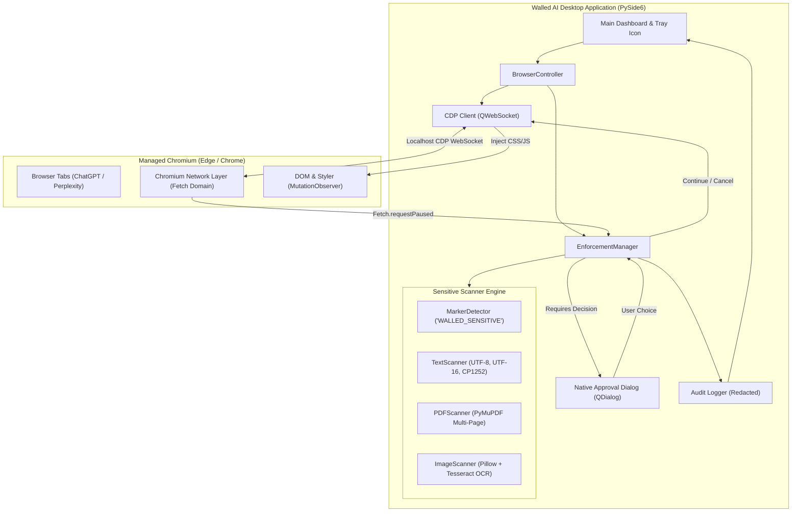

# Walled AI Sensitive Upload Guard

**A Standalone Windows Desktop Data Loss Prevention (DLP) Application for AI Platforms**

[](https://www.python.org/downloads/)
[-green.svg)](https://wiki.qt.io/Qt_for_Python)
[](https://chromedevtools.github.io/devtools-protocol/)
[-brightgreen.svg)](tests/)
[](docs/ARCHITECTURE.md)

---

## Executive Summary

**Walled AI Sensitive Upload Guard** is an enterprise-grade Windows desktop application built to prevent accidental or unauthorized data exfiltration to Generative AI web services.

The guard continuously monitors outgoing prompt submissions and file uploads destined for:
- **ChatGPT** (`https://chatgpt.com`)
- **Perplexity AI** (`https://www.perplexity.ai`)

When the predefined sensitive marker:
```text
WALLED_SENSITIVE
```
is detected within outgoing prompt text or supported file uploads (**TXT, PDF, PNG, JPG, JPEG, WebP**), the application pauses the network request at the browser engine level and raises an **always-on-top native desktop modal confirmation dialog**.

The user must make an explicit choice:
- **Continue**: Allows the transmission to proceed with the original payload intact.
- **Cancel**: Terminates the transmission at the browser network layer (`BlockedByClient`), preventing the data from leaving the local workstation while preserving the prompt text in the browser's input box for user recovery.
- **Safe Content**: Clean requests without the marker proceed instantly without dialogs or friction.

Additionally, the application modifies the visual styling of AI-generated response text on both platforms to a high-visibility theme color while strictly preserving user inputs, navigation, sidebars, and buttons.

---

## Key Features & Requirements Compliance

| Requirement | Implementation Details | Status |
| :--- | :--- | :---: |
| **Standalone Desktop Application** | Native Windows desktop GUI written in Python with PySide6 (Qt 6). Does not run inside a browser. | **Compliant** |
| **Strictly No Browser Extensions** | Operates via managed Chromium (`msedge` / `chrome`) over the Chrome DevTools Protocol (`Fetch` domain). Zero extensions, zero plugins, zero add-ons. | **Compliant** |
| **Exact Sensitive Marker Detection** | Detects exact `WALLED_SENSITIVE` token in text, surrounded by punctuation, symbols, whitespace, or embedded in paragraphs. | **Compliant** |
| **Supported File Types** | **TXT** (multi-encoding: UTF-8, BOM, UTF-16, CP1252), **PDF** (multi-page PyMuPDF scan), **Images** (PNG, JPG, JPEG, WebP via Pillow + pytesseract OCR). | **Compliant** |
| **Native Desktop Approval Dialog** | `QDialog` with `Qt.WindowStaysOnTopHint`. Safe by default (Cancel focused, Escape/Close triggers Cancel). Never uses in-browser `alert()` or `confirm()`. | **Compliant** |
| **Pre-Transmission Enforcement** | Synchronous pausing via CDP `Fetch.requestPaused`. Sensitive data is held in-flight locally before reaching cloud servers. | **Compliant** |
| **Zero Interference on Safe Content** | Clean prompts and files auto-continue via `Fetch.continueRequest` in < 2ms without interrupting the user. | **Compliant** |
| **AI Response Text Color Modification** | Dynamic CDP CSS & `MutationObserver` injection (`#2563EB`). Colorizes AI assistant markdown text on ChatGPT and Perplexity without touching user prompt bubbles. | **Compliant** |
| **Audit Logging & Privacy** | Local structured audit log. Redacts sensitive markers. Never logs prompt contents, uploaded bodies, or session bearer tokens. | **Compliant** |

---

## System Architecture



For an in-depth architectural breakdown, see [docs/ARCHITECTURE.md](docs/ARCHITECTURE.md).

---

## Installation & Prerequisites

### 1. Prerequisites
- **Operating System**: Windows 10 or Windows 11 (64-bit)
- **Python**: Version 3.10 through 3.14 (Verified on Python 3.14.7)
- **Web Browser**: Microsoft Edge (pre-installed on Windows) or Google Chrome
- **Tesseract OCR (Optional for Image Scanning)**:
  - If installed (e.g. `C:\Program Files\Tesseract-OCR\tesseract.exe`), image OCR scans PNG, JPG, JPEG, and WebP uploads.
  - If Tesseract is not installed, the application implements a **Fail-Secure** policy: uploaded images trigger the approval dialog so sensitive content is never inadvertently leaked.

### 2. Environment Setup

Clone or extract the project to your local directory:
```powershell
cd "D:\Walled_AI_Assignments\Walled AI Sensitive Upload Guard"
```

Activate or use the existing Python virtual environment (`.venv`):
```powershell
# Verify the Python executable
& ".venv\Scripts\python.exe" --version
```

If setting up a fresh environment:
```powershell
python -m venv .venv
& ".venv\Scripts\python.exe" -m pip install --upgrade pip
& ".venv\Scripts\python.exe" -m pip install -r requirements.txt
```

### 3. Verify Dependencies
```powershell
& ".venv\Scripts\python.exe" -c "import PySide6, fitz, PIL, pytesseract; print('All core libraries verified!')"
```

---

## Running the Application

### 1. Launch the Desktop GUI
Run the main desktop application:
```powershell
& ".venv\Scripts\python.exe" run.py
```

### 2. Dry-Run Verification (Command-Line)
To verify that all modules, scanners, and configuration initialize without displaying a window:
```powershell
& ".venv\Scripts\python.exe" run.py --dry-run
```

---

## How to Test and Use

### Step 1: Launch the Managed Browser
1. In the **Walled AI Sensitive Upload Guard** desktop window, locate the **Managed Browser Control** bar.
2. Click **Launch Edge (Guarded)** or **Launch Chrome (Guarded)**.
3. The application will launch an isolated browser session pre-loaded with tabs for:
   - ChatGPT: `https://chatgpt.com`
   - Perplexity: `https://www.perplexity.ai`
4. The dashboard status indicators will switch:
   - **Guard Status**: `Active (Running)`
   - **CDP**: `Connected`
   - **Interception**: `Active (CDP Fetch)`
   - **ChatGPT / Perplexity**: `Detected`

### Step 2: Test Sensitive Prompt Interception
1. Switch to the managed browser's ChatGPT or Perplexity tab.
2. In the prompt textarea, type a prompt containing the sensitive marker:
   ```text
   Please summarize this confidential report: WALLED_SENSITIVE project data.
   ```
3. Press **Enter** or click **Send**.
4. **Result**:
   - Outgoing transmission is instantly paused at the browser network layer.
   - The native desktop confirmation dialog appears on top of all windows with a red warning badge.
   - The dialog specifies the platform, content type (`Prompt`), and truncated context snippet.

### Step 3: Test Decision Actions
- **Cancel (Default / Safe Action)**:
  - Press `Escape`, click `Cancel`, or close the dialog (`X`).
  - The request is immediately blocked (`Fetch.failRequest: BlockedByClient`).
  - In the browser, the prompt text remains in the input textarea so the user does not lose their work.
  - The desktop dashboard increments `Prompts Blocked` and logs the event to the audit table.
- **Continue (Explicit Override)**:
  - Click `Continue`.
  - The request is resumed (`Fetch.continueRequest`) with original payload intact.
  - The AI model responds as normal.
  - The desktop dashboard increments `Prompts Allowed`.

### Step 4: Test Safe Content (Zero Friction)
1. In the browser, submit a standard non-sensitive prompt:
   ```text
   What is the distance between Earth and Mars?
   ```
2. **Result**:
   - The prompt transmits instantaneously without any dialog or hesitation.
   - No sensitive detections are recorded.

### Step 5: Test File Upload Protection
1. Prepare a test file containing `WALLED_SENSITIVE`:
   - **TXT**: `sample.txt` containing `Internal Secret: WALLED_SENSITIVE`
   - **PDF**: A single or multi-page PDF with `WALLED_SENSITIVE` on any page.
   - **Image**: A PNG or JPG containing image text with `WALLED_SENSITIVE`.
2. Attach the file in ChatGPT or Perplexity.
3. **Result**:
   - The multipart upload stream is paused and extracted in memory.
   - The native approval dialog displays: `File Upload (TXT)` or `File Upload (PDF)`.
   - The user can authorize or cancel transmission.

### Step 6: Verify AI Response Color Modification
1. Submit any safe prompt and wait for the AI assistant's reply.
2. **Result**:
   - The assistant's text is styled in high-visibility blue (`#2563EB`).
   - The user's prompt bubble, buttons, sidebar, and navigation retain standard native styling.

---

## Running the Automated Test Suite

The project includes an exhaustive automated test suite covering all units, scanners, edge cases, CDP socket flows, and end-to-end integration:

```powershell
& ".venv\Scripts\python.exe" -m pytest tests/ -v
```

### Test Coverage Highlights (137 Tests Passing):
- **`test_detector.py`**: Marker detection, case sensitivity, punctuation, substring boundaries.
- **`test_text_scanner.py`**: Multi-encoding parsing (UTF-8, UTF-8 BOM, UTF-16 LE/BE, CP1252, Latin-1).
- **`test_pdf_scanner.py`**: PyMuPDF multi-page scanning, corrupt files, blank pages, zero-page documents.
- **`test_image_scanner.py`**: Pillow image preprocessing, upscale filters, pytesseract OCR, fail-secure fallbacks.
- **`test_payload_extractor.py`**: JSON prompt recursion, form-urlencoded extraction, binary-safe multipart file stream parsing.
- **`test_enforcement_manager.py`**: Synchronous request pause, auto-continue of clean requests, approval dialog triggers, 60s safety timeout, strictly-once resolution.
- **`test_response_styler.py`**: Assistant selector scoping, prohibited selector protection (user prompts, navbars), persistent MutationObserver JS injection.
- **`test_approval_dialog.py`**: Native PySide6 dialog lifecycle, focus trapping on Cancel, Escape key interception, WindowStaysOnTopHint.
- **`test_integration_e2e.py`**: Full pipeline integration from CDP pause through scanner, UI dialog, and terminal network action.

---

## Security & Privacy Considerations

1. **Strict Localhost CDP Binding**:
   - The managed browser's remote debugging port is dynamically allocated and bound strictly to `127.0.0.1`. It never listens on public interfaces (`0.0.0.0`).
2. **Zero Extension Architecture**:
   - Browser extensions can be disabled, bypassed, or inspected in developer mode. By utilizing native desktop-controlled CDP, enforcement logic cannot be altered by scripts inside the browser DOM.
3. **No Man-in-the-Middle (MitM) Root CAs**:
   - Does not install custom root certificates into the Windows Certificate Store, preserving TLS trust integrity.
4. **Privacy-Preserving Audit Logging**:
   - The audit log stores metadata (timestamp, target site, filename, detection reason, user decision).
   - Raw prompt text and file bodies are **never persisted** to disk.
5. **Fail-Secure Upload Policy**:
   - If a file upload stream cannot be conclusively verified (e.g., unsupported format, corrupted file, or missing OCR binary), the application holds the request and requests user confirmation rather than silently allowing transmission.

---

## Project Structure

```text
Walled AI Sensitive Upload Guard/
│
├── run.py                          # Main application entry point CLI
├── requirements.txt                # Production and test dependencies
├── .gitignore                      # Git exclusion rules
├── README.md                       # Complete project overview & instructions
│
├── app/                            # Application package
│   ├── __init__.py
│   ├── main.py                     # PySide6 application factory & runner
│   │
│   ├── config/                     # Configuration management
│   │   ├── __init__.py
│   │   └── settings.py             # AppConfig, target domains, marker definition
│   │
│   ├── scanner/                    # DLP Content Scanning Engine
│   │   ├── __init__.py
│   │   ├── models.py               # ScanResult data structures
│   │   ├── detector.py             # WALLED_SENSITIVE token detector
│   │   ├── text_scanner.py         # Multi-encoding text scanner
│   │   ├── pdf_scanner.py          # PyMuPDF multi-page PDF scanner
│   │   ├── image_scanner.py        # Pillow + Tesseract OCR image scanner
│   │   └── unified_scanner.py      # Multi-type scanner dispatcher
│   │
│   ├── browser/                    # Managed Browser & CDP Subsystem
│   │   ├── __init__.py
│   │   ├── models.py               # CandidateRequest, CDPStatus, ApprovalDecision
│   │   ├── site_detection.py       # Domain and platform matching
│   │   ├── request_classifier.py   # Outgoing HTTP request heuristics
│   │   ├── payload_extractor.py    # JSON & multipart stream payload parsing
│   │   ├── browser_manager.py      # Edge/Chrome discovery, launch & process lifecycle
│   │   ├── cdp_client.py           # Multi-tab QWebSocket CDP client
│   │   ├── enforcement_manager.py  # Synchronous DLP request pause/continue/fail
│   │   ├── response_styler.py      # Assistant text color styler & MutationObserver
│   │   └── browser_controller.py   # High-level controller coordinating GUI & CDP
│   │
│   ├── desktop/                    # Native PySide6 Desktop GUI
│   │   ├── __init__.py
│   │   ├── approval_dialog.py      # Modal always-on-top approval dialog
│   │   ├── main_window.py          # Dashboard window, metric cards, audit table
│   │   └── tray.py                 # System tray icon & background notifications
│   │
│   └── security/                   # Security & Audit Logging
│       ├── __init__.py
│       └── audit_logger.py         # Privacy-preserving audit log
│
├── docs/                           # Documentation deliverables
│   ├── ARCHITECTURE.md             # Detailed architecture & technical design
│   └── DEMO_SCRIPT.md              # Reviewer demonstration & recording guide
│
├── tests/                          # Automated test suite (137 tests)
│   ├── test_foundation.py
│   ├── test_detector.py
│   ├── test_text_scanner.py
│   ├── test_pdf_scanner.py
│   ├── test_image_scanner.py
│   ├── test_unified_scanner.py
│   ├── test_approval_dialog.py
│   ├── test_dashboard.py
│   ├── test_site_detection.py
│   ├── test_request_classifier.py
│   ├── test_payload_extractor.py
│   ├── test_browser_manager.py
│   ├── test_cdp_client.py
│   ├── test_enforcement_manager.py
│   ├── test_response_styler.py
│   ├── test_file_bridge.py
│   └── test_integration_e2e.py
```

---

## License & Attribution

Designed and built as a standalone desktop Data Loss Prevention solution for the **Walled AI Sensitive Upload Guard** hiring assignment.
