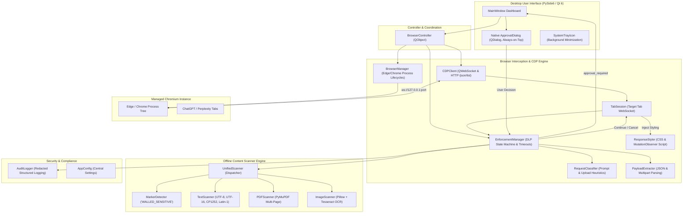
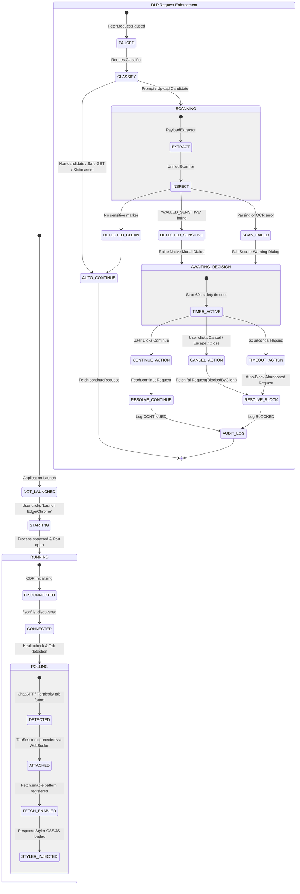

# Walled AI Sensitive Upload Guard — Technical Architecture Document

## 1. Architectural Overview

**Walled AI Sensitive Upload Guard** is an out-of-process, native Windows desktop Data Loss Prevention (DLP) system designed to monitor, intercept, and govern interactions with Generative AI platforms (**ChatGPT** and **Perplexity AI**).

The system enforces strict pre-transmission inspection of outgoing prompt text and file attachments for the sensitive marker:
```text
WALLED_SENSITIVE
```

### Core Architectural Axioms
1. **Desktop-First Control**: All policy enforcement, scanning, approval workflows, and audit logging execute within the standalone native Windows desktop process.
2. **Zero Extension Architecture**: Browser extensions, plugins, and add-ons are strictly prohibited. The system controls standard enterprise Chromium browsers (Microsoft Edge or Google Chrome) directly via the Chrome DevTools Protocol (CDP).
3. **Synchronous Pre-Transmission Pausing**: Requests are intercepted and held in-flight before the browser transmits bytes over the wire. Content is never allowed to reach external cloud infrastructure without explicit authorization.
4. **Preserve User Context on Block**: When a prompt or upload is blocked by the user, the browser network request is failed locally (`BlockedByClient`), allowing the browser's Single-Page Application (SPA) to keep the text in the input textarea so the user does not lose their work.
5. **Fail-Secure Security Posture**: If an upload stream or file format cannot be parsed or verified conclusively, the request is held and presented to the user with an explicit confirmation warning; it is never silently passed through.

---

## 2. High-Level Component Architecture



---

## 3. Technology Trade-Off Analysis

During Phase 0, two primary architectural approaches were evaluated:

| Architectural Dimension | Managed Chromium CDP (Selected) | Local HTTPS Interception Proxy (mitmproxy) |
| :--- | :--- | :--- |
| **System Security & Trust** | **Superior**: Zero custom Root Certificates required. Does not touch the Windows Certificate Store or compromise OS TLS validation. | **Risk**: Requires installing an untrusted Root CA into the Windows Trusted Root Store. Vulnerable if private key is leaked. |
| **Strictly No Extensions** | **Fully Compliant**: Intercepts at the browser engine level via remote debugging socket. | **Compliant**: Operates at network socket layer. |
| **Request Pausing** | **Precise**: `Fetch.requestPaused` synchronously halts the HTTP pipeline in-flight. | **Moderate**: Can hold TCP stream, but lacks browser DOM integration. |
| **User Experience on Cancel** | **Superior**: Emitting `Fetch.failRequest(BlockedByClient)` cancels the fetch while preserving input text in the textarea for user recovery. | **Inferior**: Resetting connection causes browser to display ugly network error pages or clear state. |
| **Response Text Styling** | **Direct & Non-Invasive**: Script and CSS injected via `Page.addScriptToEvaluateOnNewDocument` and `Runtime.evaluate`. Works seamlessly with SPAs. | **Complex & Fragile**: Requires parsing, decrypting, decompressing (gzip/brotli/zstd), injecting HTML/JS, and re-signing TLS streams. |
| **Performance Overhead** | **Zero Network Overhead**: Requests flow directly from browser to target cloud. Only inspected domains are routed through the CDP event pipeline. | **Double-Hop Overhead**: Every single TCP/TLS connection on the system is routed through local proxy process. |

**Conclusion**: Managed Chromium CDP was selected as the optimal architecture for privacy, stability, security, and developer ergonomics.

---

## 4. DLP Request Lifecycle & State Machine



---

## 5. Content Scanning Subsystem

The scanning engine (`app/scanner/`) operates completely offline with zero network requests.

### 5.1 Marker Detection (`detector.py`)
- Searches for the exact predefined token: `WALLED_SENSITIVE`.
- Regex matching: `\bWALLED_SENSITIVE\b` with fallback to literal substring scan.
- Handles edge cases: marker flanked by punctuation (e.g. `[WALLED_SENSITIVE]`, `"WALLED_SENSITIVE"`, `WALLED_SENSITIVE.`), whitespace variations, and multi-line occurrences.

### 5.2 Text Scanner (`text_scanner.py`)
- Handles text files (`.txt`).
- **Encoding Precedence**:
  1. Explicit Byte Order Mark (BOM) inspection: UTF-8 BOM (`\xef\xbb\xbf`), UTF-16 LE (`\xff\xfe`), UTF-16 BE (`\xfe\xff`).
  2. Standard UTF-8 strict decode.
  3. Windows CP1252 (Western European).
  4. ISO-8859-1 (Latin-1 fallback).
  5. Fallback UTF-16 with surrogate pair handling.
- Prevents UTF-16 false-positive decoding on Latin-1 text by enforcing explicit BOM checks before blind UTF-16 decoding.

### 5.3 PDF Scanner (`pdf_scanner.py`)
- Built upon **PyMuPDF (`fitz`)**.
- Traverses every page sequentially (1-indexed reporting).
- Extracts text via `page.get_text("text")`.
- Resilient error handling: detects and handles empty 0-page PDFs, blank pages, and malformed/corrupted files gracefully without process crashes.

### 5.4 Image Scanner & OCR (`image_scanner.py`)
- Built upon **Pillow (`PIL`)** and **pytesseract**.
- **Preprocessing Pipeline**:
  1. Image loading and format verification (PNG, JPG, JPEG, WebP).
  2. Conversion to Grayscale (`L` mode).
  3. Adaptive LANCZOS upscaling for low-resolution image inputs (< 300 DPI).
  4. Autocontrast enhancement to maximize character segmentation clarity.
- **Fail-Secure Architecture**:
  If the Tesseract binary is not installed on the system, the scanner reports an error (`OCR engine unavailable`). The DLP enforcement engine catches this error and treats it as a potential risk, raising the approval dialog so the user can make an informed decision.

---

## 6. AI Response Text-Color Modification

The assignment requires:
> *"Additionally, change the color of AI-generated response text on both websites."*

### Implementation Architecture (`app/browser/response_styler.py`)
1. **Target Selector Scoping**:
   - **ChatGPT Assistant Responses**:
     - `[data-message-author-role="assistant"] .markdown p`
     - `[data-message-author-role="assistant"] .markdown li`
     - `[data-message-author-role="assistant"] .markdown h1, h2, h3`
     - `[data-message-author-role="assistant"] .prose p`
     - `.agent-turn .markdown p`
   - **Perplexity Answers**:
     - `div[class*="prose"] p`
     - `div[class*="prose"] li`
     - `[data-testid="answer-text"] p`
2. **Strict Exclusions**:
   - User prompt bubbles (`[data-message-author-role="user"]`, `.user-turn`, textareas, inputs) are explicitly excluded from colorization rules.
   - Syntax highlighting in code blocks is preserved via:
     ```css
     [data-message-author-role="assistant"] pre code,
     div[class*="prose"] pre code {
         color: inherit;
     }
     ```
3. **Dynamic SPA DOM Handling**:
   - ChatGPT and Perplexity stream tokens into the DOM dynamically.
   - An injected script attaches a `MutationObserver` that watches `document.documentElement` for DOM tree modifications and ensures the style element (`#walled-ai-response-styler`) remains active and attached.
   - Registered via CDP `Page.addScriptToEvaluateOnNewDocument` (executes on every page load and client-side navigation) and `Runtime.evaluate` (applies immediately to currently open tabs).

---

## 7. Security & Threat Modeling

| Threat / Risk Vector | Mitigation in Walled AI Guard |
| :--- | :--- |
| **Unauthorized Remote CDP Access** | Remote debugging port is bound strictly to `127.0.0.1`. The port is randomly selected from available high ports at runtime. Never listens on `0.0.0.0`. |
| **Extension Tampering / Disabling** | Zero extensions used. All interception code runs in the desktop Python runtime. Cannot be disabled in `chrome://extensions`. |
| **Data Leakage via Audit Logs** | Audit logger records only metadata (timestamp, domain, file type, decision). Prompts and file bodies are never written to disk. |
| **Abandonment of Approval Dialog** | 60-second safety timeout automatically blocks unresolved requests if the user walks away from the workstation. |
| **Accidental Enter Key Press** | Approval dialog sets Cancel as the default and initially focused button. Enter key triggers Cancel, not Continue. |
| **Binary Stream Corruption in Multiparts** | Multipart stream parsing decodes raw postData using ISO-8859-1 (Latin-1), guaranteeing a lossless 1:1 byte mapping (0x00–0xFF) so binary PDFs and images are not corrupted during in-memory inspection. |
